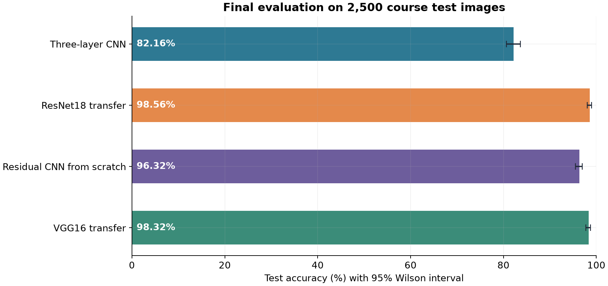

# MLT Assignment 4: CNNs and Transfer Learning

**Hazem Daw | Group J4132**  
Machine Learning Technologies, ITMO University, 2026

[Open the executed notebook](CNN_and_Transfer_Learning_Pytorch.ipynb) · [Read the report](REPORT.md)

Cats-versus-dogs classification with the required three-layer CNN, VGG16 and ResNet18 transfer learning, plus a separate residual CNN trained entirely from scratch for the optional contest. All reported results were measured on an NVIDIA RTX 3060; no scores or learning curves are simulated.

## Results

| Model | Pretrained weights | Selected epoch | Test accuracy | Test BCE | 95% Wilson interval |
|---|---|---:|---:|---:|---|
| Three-layer CNN | None | 9 | 82.16% | 0.3842 | 80.61% - 83.61% |
| ResNet18 transfer | ImageNet | 11 | 98.56% | 0.0433 | 98.01% - 98.96% |
| Residual CNN (contest) | None | 51 | 96.32% | 0.1137 | 95.51% - 96.99% |
| VGG16 transfer | ImageNet | 1 | 98.32% | 0.0481 | 97.74% - 98.75% |

The inference model is **ResNet18 transfer**, selected by validation BCE before test evaluation. The contest entry is **Residual CNN**, with **2408/2,500 correct (96.32%)**. It uses no pretrained weights. The 5A award is a class competition: this repository does not claim a winning rank.

The reported contest result uses horizontal-flip logit averaging, selected on validation data. To reproduce contest inference from its checkpoint, use `python inference.py IMAGE --checkpoint checkpoints/scratch.pt --tta`.



## Review the saved submission

The notebook contains saved outputs and plots, so GitHub can display the results without running training. To rerun the analysis and custom-image inference locally:

```bash
python -m venv .venv
# Activate .venv using the command for your shell.
python -m pip install -r requirements.txt
python download_checkpoints.py
python -m ipykernel install --user --name mlt-task4 --display-name "MLT Task 4"
```

Open `CNN_and_Transfer_Learning_Pytorch.ipynb`, select the environment, and run all cells. Keep `RUN_TRAINING=False` to review the measured run. Saved-results mode needs the repository files and downloaded checkpoints, but does not require the course dataset. The notebook is not a disconnected single-file notebook.

Alternatively, `python run_notebook.py` executes it and exports an HTML copy. This runner includes a PyTorch-before-kernel loading workaround for Windows DLL conflicts. `python validate_results.py` verifies the saved scores, checkpoint hashes and executed notebook.

For NVIDIA CUDA 12.8, install the matching build before the requirements:

```bash
python -m pip install torch==2.11.0 torchvision==0.26.0 --index-url https://download.pytorch.org/whl/cu128
```

## Reproduce training

```bash
python prepare_data.py
python verify.py
python run_all.py
python build_artifacts.py
python write_report.py
```

`prepare_data.py` downloads the original course archive (about 1.1 GB), checks image decoding and hashes, and preserves the supplied split. `run_all.py` trains all four models, locks validation choices, then evaluates the test set. Training can also be repeated by setting `RUN_TRAINING=True` in the notebook. Internet is required for the course archive and initial torchvision weights. A CUDA GPU is recommended; CPU training is supported but slower.

The recorded experiment budgets are:

```bash
python train.py --model cnn --epochs 15 --batch-size 128
python train.py --model vgg16 --epochs 15 --batch-size 64
python train.py --model resnet18 --epochs 15 --batch-size 64
python train.py --model scratch --epochs 60 --size 128 --batch-size 128
python evaluate.py
```

## Custom-image inference

```bash
python inference.py custom_images/dog.jpg --checkpoint checkpoints/resnet18.pt
```

The function converts images to RGB, handles EXIF orientation, applies the checkpoint's preprocessing, and returns a class and both probabilities. Confidence is a model output, not a calibration guarantee.

## Data and reproducibility

- Original counts: 20,000 train, 2,490 validation, 2,500 test; both test classes contain 1,250 images.
- Five duplicate training copies are excluded, leaving **19,995** training images. Validation/test images are retained. Three groups cross split boundaries; two are within training.
- Class map: `cats=0`, `dogs=1`. Logits are trained with BCEWithLogitsLoss; the threshold is fixed at 0.5.
- Seed 42, deterministic cuDNN settings, seeded data-loader workers. Exact results may vary across hardware/library versions.
- Minimum validation BCE selects checkpoints. The scratch model's horizontal-flip test-time augmentation is selected using validation data alone.
- The two ImageNet models are exclusively Part 2; the Part 3 model is initialized randomly and never uses their features or weights.
- Checkpoint files are distributed in the GitHub release, with SHA-256 verification via `download_checkpoints.py`. Dataset and feature caches are not committed.

## Files

| File/folder | Purpose |
|---|---|
| `CNN_and_Transfer_Learning_Pytorch.ipynb` | Completed exercise, explanations, implementations and saved outputs |
| `models.py`, `train.py` | Model definitions and reusable training engine |
| `prepare_data.py` | Safe extraction, image checks and duplicate audit |
| `evaluate.py`, `inference.py` | Locked evaluation and custom-image prediction |
| `results/` | Configurations, epoch histories, data hashes, test predictions and metrics |
| `figures/` | Learning curves, confusion matrices, comparison and error analysis |
| `verify.py` | Focused numerical and model-behavior checks |
| `custom_images/` | External inference example and provenance |

Sources: supplied Task 4 PDF, lecture 7 and course PyTorch notebook; [torchvision VGG16](https://docs.pytorch.org/vision/stable/models/generated/torchvision.models.vgg16.html), [torchvision ResNet18](https://docs.pytorch.org/vision/stable/models/generated/torchvision.models.resnet18.html), and the [course dataset](https://drive.google.com/drive/folders/1KpT0oBIb3aDaBtjf7Hs4WAUPoFEpbsYr).
