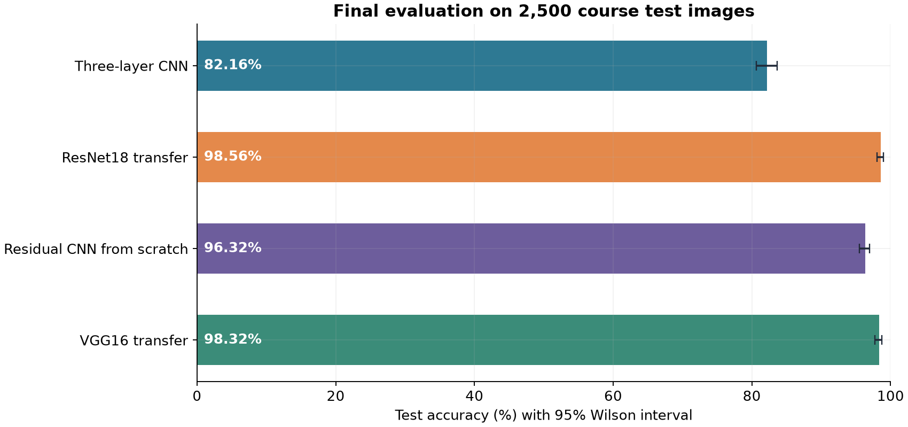

# Assignment 4: experimental report

**Hazem Daw | J4132**

## Objective and protocol

The task is binary classification of cat and dog photographs. The provided split is retained, with five duplicate training copies removed using exact decoded-pixel hashes before fitting. There are 19,995 training images, 2,490 validation images and 2,500 test images. No image failed decoding. The archive contains ten fewer validation cats than the 25,000-image total described by the example notebook.

Model weights use only training data. Validation BCE selects the checkpoint and whether the contest model uses horizontal-flip logit averaging. Architecture, training budgets and inference choices are fixed before final test evaluation. The supplied test set contains two identical dog photographs; confidence intervals therefore approximate the independent-sample setting.

## Architectures and optimization

**Baseline:** the specified 16/32/64-channel CNN, three 3x3 convolutions with ReLU and max pooling, then 64 hidden units, dropout 0.5 and one logit. Input is 150x150 with pixels in [0,1]. It trains for 15 epochs at learning rate 0.001.

**VGG16:** frozen ImageNet V1 convolutional features, adaptive 7x7 pooling and a new 25,088 -> 256 -> 1 head with dropout 0.5. Only the head trains, for 15 epochs at 0.0001.

**ResNet18:** frozen ImageNet V1 features and a new 512 -> 256 -> 1 head. BatchNorm running statistics remain frozen. The head trains for 15 epochs at 0.001. Both transfer models use torchvision's weight-specific 224-pixel preprocessing. Deterministic float16 feature caches save repeated backbone passes; training promotes features to float32.

**Contest:** a residual CNN with channels 32/64/128/256, global average pooling and dropout 0.2. Every parameter starts from random initialization. It trains for 60 epochs at 128x128 with random resized crops, flips, mild color jitter, label smoothing 0.05, AdamW (initial learning rate 0.002, weight decay 0.0001), and cosine decay. Its training loss uses smoothed labels; validation/test losses use hard labels. No pretrained features, weights, distillation or external training images are used.

## Measured results

| Model | Pretrained weights | Selected epoch | Test accuracy | Test BCE | 95% Wilson interval |
|---|---|---:|---:|---:|---|
| Three-layer CNN | None | 9 | 82.16% | 0.3842 | 80.61% - 83.61% |
| ResNet18 transfer | ImageNet | 11 | 98.56% | 0.0433 | 98.01% - 98.96% |
| Residual CNN (contest) | None | 51 | 96.32% | 0.1137 | 95.51% - 96.99% |
| VGG16 transfer | ImageNet | 1 | 98.32% | 0.0481 | 97.74% - 98.75% |

The validation-selected inference model is **ResNet18 transfer**. The contest-eligible result is **96.32%**, or **2408 correct predictions out of 2,500**. These are separate categories: pretrained models cannot qualify for Part 3. A constant-class predictor scores 50% on this balanced test set.

## Interpretation and limits

The baseline's training accuracy improves beyond the epoch with minimum validation loss, illustrating why the final epoch is not automatically the best checkpoint. Cross-entropy also penalizes confidently wrong predictions, so its optimum need not coincide with maximum accuracy. Frozen pretrained features exploit a much larger upstream training dataset; this comparison does not isolate architecture as the only cause of differences.

The notebook includes confusion matrices, both accuracy and loss curves for every model, and the selected model's most confident errors. Several shown mistakes contain both species, making a single class label ambiguous; others have small subjects or poor lighting. The original test labels were retained. Error inspection was performed after fitting and was not fed back into model tuning. A separately sourced dog photo demonstrates inference. It is not a statistical evaluation, and overlap between that photograph and ImageNet cannot be ruled out.

There is one training seed per architecture. Wilson intervals describe test-sample uncertainty only, not training-seed variation. Class ranking and other students' scores are unavailable, so an automatic 5A cannot be established from these experiments alone. Higher-resolution training, multiple scratch seeds and validation-selected ensembling are potential follow-ups, not measured claims in this submission.

## Reproducibility evidence

`results/selection.json` records decisions and checkpoint hashes before test evaluation. Per-image probabilities are saved in each model's `test_predictions.csv`. `data_manifest.csv` records every image's split, class, dimensions and file/pixel SHA-256. Configurations and all per-epoch measurements are saved. `verify.py` checks logits, gradient flow, frozen BatchNorm, weighted evaluation, and image conversion. See README for exact commands.
